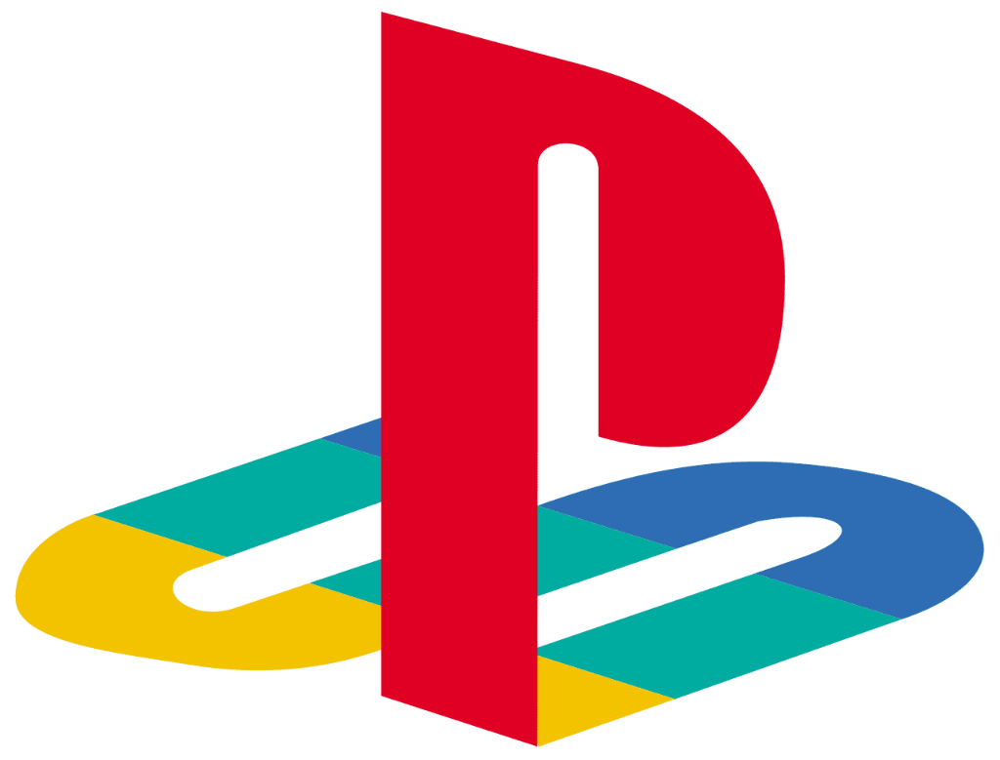

<p align="center">
  
</p>

<h1 align="center">psn checker</h1>

<p align="center">
  <strong>v1.0 &bull; Release Build</strong><br>
  Minimal, OLED-native PlayStation Network library inspector, entitlement classifier & playtime analyzer.
</p>

<p align="center">
  <a href="#features">Features</a> &bull;
  <a href="#quick-start">Quick Start</a> &bull;
  <a href="#documentation-index">Documentation</a> &bull;
  <a href="#how-to-use">How to Use</a> &bull;
  <a href="#faq">FAQ</a> &bull;
  <a href="#export-options">Export</a>
</p>

---

## Documentation Index

Detailed architectural and technical markdown guides are separated into dedicated files to accelerate development and eliminate reading fatigue:

- 🏗️ **[System Architecture](docs/ARCHITECTURE.md)**: High-level design, Server-Sent Events (SSE) streaming pipeline, data models, and entitlement separation logic.
- 📡 **[Backend API Reference](docs/API_REFERENCE.md)**: Complete endpoint documentation for `/api/health`, `/api/fetch-stream`, `/api/library`, and `/api/download/*`.
- 🎨 **[Frontend & Design System](docs/FRONTEND.md)**: Pure OLED tokens, squash-proof Flexbox rules, guaranteed 1:1 square artwork, micro-animations, and mobile touch ergonomics.
- 🔒 **[Security & Privacy Architecture](docs/SECURITY.md)**: Zero-retention token policy, defensive HTTP security headers (CSP, nosniff), in-memory IP rate limiter, and sanitization protocols.
- 🛠️ **[Developer Guide & Code Map](docs/DEVELOPMENT_GUIDE.md)**: Codebase directory tree, step-by-step feature addition, and section-by-section code index.

---

## Features

- **Pure OLED Aesthetics**: Deep `#000000` dark theme with high-contrast monochrome design, clean typography (Google Sans & JetBrains Mono), and sharp responsive layout.
- **Accurate Entitlement Separation**: Distinguishes perpetual digital purchases from PlayStation Plus subscription claims across PS5 and PS4.
- **Squash-Proof Game List**: Strict Flexbox safeguards (`flex-shrink: 0; min-height: 64px`) ensuring zero text clipping and guaranteed 1:1 square cover art on desktop and mobile.
- **Touch-Friendly Mobile Tabs**: Seamless horizontal scroll tab bar with hidden scrollbars for mobile screens.
- **Real-Time SSE Streaming**: Live Server-Sent Events pipeline streaming status logs, percentage progress, and ETA updates without blocking the browser.
- **Flexible Exporters**: One-click grouped text copy (PS4 / PS5 sections) and CSV spreadsheet download with playtime metrics.
- **Built-In About & FAQ**: Native in-app modal detailing usage instructions, security guarantees, and author credits.

---

## Quick Start

```bash
# 1. Install dependencies
npm install

# 2. Launch web server
npm run web
# OR
npm start
```

Open `http://localhost:3000` in your browser.

---

## How to Use

1. Sign into your PlayStation account at [playstation.com](https://www.playstation.com).
2. Open Sony's SSO cookie endpoint in the same browser:
   ```text
   https://ca.account.sony.com/api/v1/ssocookie
   ```
3. Copy the 64-character token inside the JSON quotes:
   ```json
   {"npsso": "your_64_character_token_here"}
   ```
4. Paste it into the token field and click **CONNECT & FETCH**.

---

## FAQ

#### Is this safe to use?
**Yes, 100%.** This application runs locally on your machine and is open source. You never enter your PlayStation password. Your NPSSO token is transmitted directly to Sony's official OAuth servers over encrypted HTTPS, and is never logged, stored on external servers, or shared with third parties.

#### How does it work?
It uses Sony's official OAuth 2.0 gateway. The 64-character NPSSO token exchanges for a temporary access code, which generates a short-lived bearer token. It then queries Sony's official GraphQL catalog (`getPurchasedGames`) and activity history APIs to separate perpetual digital purchases from subscription-based PS Plus claims.

#### Can my PlayStation account get banned?
**No.** All requests are standard, read-only API calls—the exact same requests made by the official PlayStation Mobile App and web library to display your games.

#### Where is my data stored?
Strictly on your own computer in `psn-game-library.json` and `psn-game-library.csv`. No telemetry, analytics, or external databases are used.

---

## Export Options

- **Copy Simple List**:
  - `Copy without PS+ list`: Copies owned digital purchases only.
  - `Copy with PS+ list`: Copies all games including claimed PS+ titles.
  - Clean format: Games grouped under PS4 and PS5 headers, sorted alphabetically.
- **CSV Export**: Full dataset saved as `psn-game-library.csv` including Title IDs, Entitlement IDs, and playtime.

---

<p align="center">
  <sub>Built with ❤️ by <a href="https://github.com/nimalanrao">@nimalanrao</a></sub>
</p>
