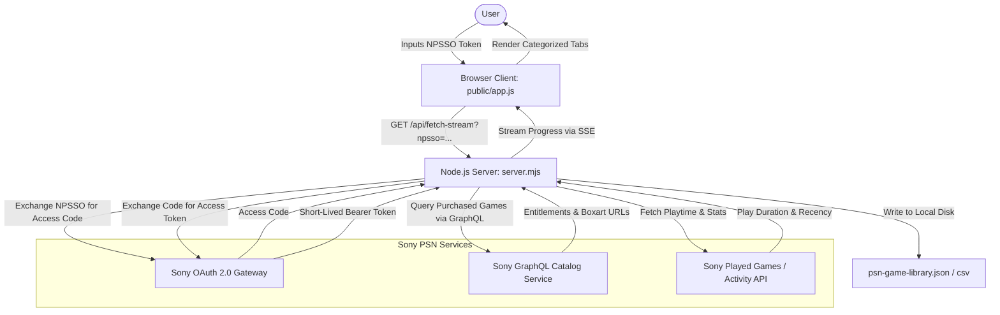
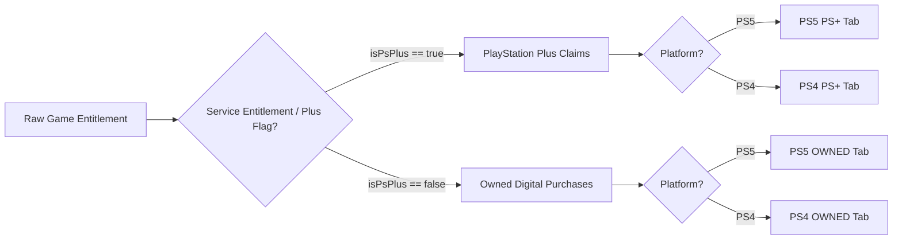

# System Architecture

This document describes the high-level system architecture, data flow, lifecycle states, and entitlement classification of the PlayStation Network (PSN) Library Inspector.

---

## 1. High-Level Architecture Overview

The application is structured into three primary tiers:
1. **Frontend Client (`public/`)**: A zero-dependency Vanilla ES / CSS application that provides an OLED dark interface, real-time Server-Sent Events (SSE) consumption, responsive tabs with horizontal swipe on mobile, and modal inspectors.
2. **Local Node.js Server (`server.mjs`)**: An HTTP service running locally on Node.js using native modules (`node:http`, `node:fs`, `node:path`). It orchestrates OAuth token exchanges, queries Sony's official endpoints, and streams progress back to the browser.
3. **Sony PlayStation Services**: Official Sony OAuth 2.0 endpoints (`ca.account.sony.com`), GraphQL catalog services (`getPurchasedGames`), and profile/activity endpoints (`getUserPlayedGames`).

---

## 2. Server-Sent Events (SSE) Streaming Pipeline

Instead of a blocking REST request that times out when querying hundreds of entitlements across multiple paginated Sony endpoints, the server uses **Server-Sent Events** over HTTP:

1. **Client Connection**: Browser opens `EventSource('/api/fetch-stream?npsso=' + encodeURIComponent(token))`.
2. **Event Types**:
   - `event: status`: Transmits human-readable status logs (e.g., `Exchanging NPSSO token...`, `Fetching page 1...`).
   - `event: progress`: Transmits percentage completion integer (`0` to `100`) and optional ETA string for smooth progress bar updates.
   - `event: done`: Emits final payload `{ success: true, count: N, user: {...} }` signaling completion. The browser closes the EventSource connection and transitions to the dashboard.
   - `event: error`: Emits error payload `{ error: message }` if token exchange fails or network errors occur.

---

## 3. Data Processing & Entitlement Separation

A key value proposition of this application is accurately separating **perpetual digital purchases** from **PlayStation Plus subscription claims**:

### Entitlement Classification Attributes:
- **`isPsPlus` (`boolean`)**: Flag indicating whether the title is bound to a PlayStation Plus subscription entitlement or acquired through PS Plus monthly drops.
- **`platform` (`string`)**: Normalized target platform identifier (`"PS4"`, `"PS5"`, or `"UNKNOWN"`).
- **`titleId` / `entitlementId`**: Sony product identifiers extracted from entitlement metadata.
- **`playtime` (`string`)**: Playtime duration normalized to `"X.Yh"` or `"<1h"` via ISO duration parser.
- **`imageUrl` (`string`)**: Sony CDN boxart image link, guaranteed to render as 1:1 square artwork.

---

## 4. Local Persistence Model

All scanned data is stored exclusively on the host filesystem:
- **`psn-game-library.json`**: Master JSON representation containing account profile summary, total counts, and full array of game objects.
- **`psn-game-library.csv`**: Tabular CSV export containing columns: Title, Platform, License Type, Title ID, Entitlement ID, Playtime, Play Count, Last Played, and Boxart URL.

No cloud databases, external analytics, or third-party tracking services are connected.
